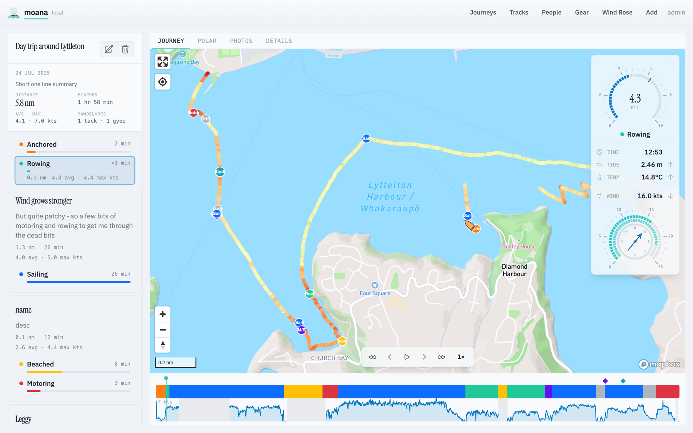
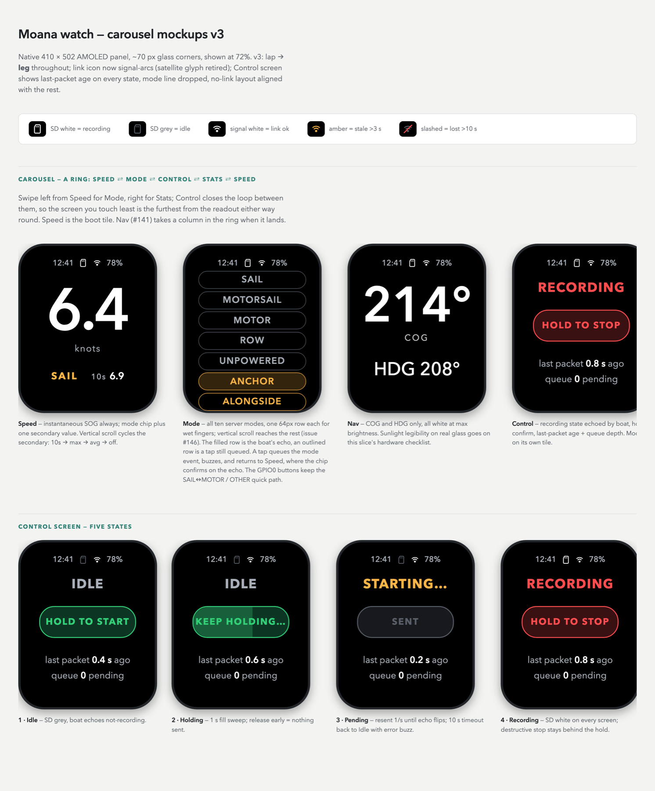
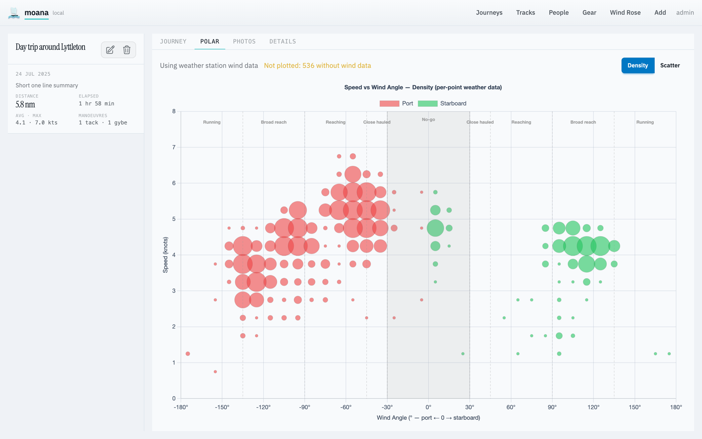
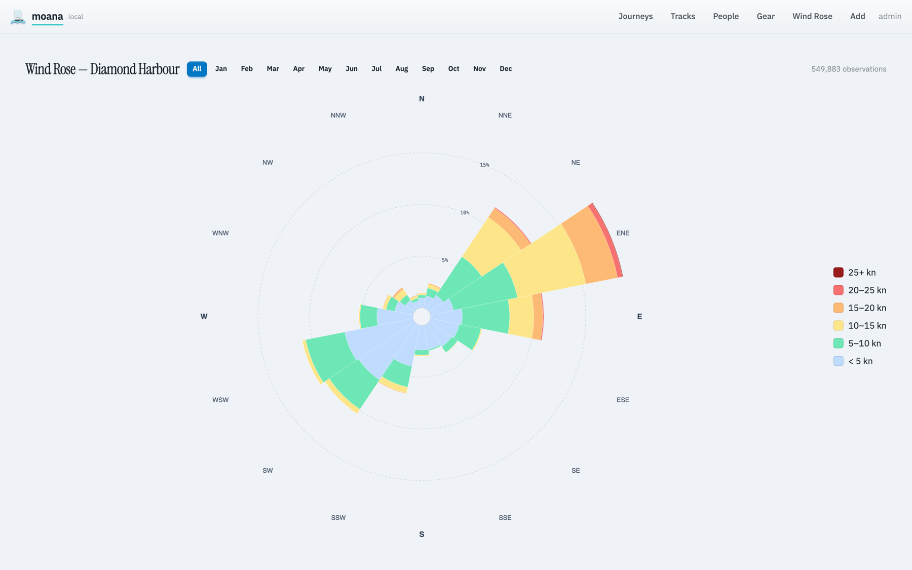

# Moana

A sailing logger I built for my own dinghy: an ESP32-S3 on the boat records GPS and attitude,
a smartwatch on my wrist shows speed and tags what the boat is doing, and a web app turns each
day on the water into a journey you can replay.

> **This is a showcase snapshot.** The code is the real project, published as a single commit
> without its history or private deployment config. Issue numbers such as `#146` in comments
> refer to the private working repository.



## What it does

- **Boat unit** (M5Stack CoreS3, ESP32-S3) records 1 Hz GPS fixes plus heel, trim and heading
  from a fused IMU to flash, shows live readouts on its touchscreen, and serves the tracks and
  the web app itself over WiFi.
- **Watch** (LilyGo T-Watch Ultra) receives telemetry from the boat over ESP-NOW and shows
  speed, session statistics and recording state. One tap tags the current leg (sail, motor,
  row, anchored…); a hold-to-confirm starts or stops recording on the boat. Everything it sends
  is queued, acknowledged and echoed back, so a dropped link never loses a tap.
- **Server** (Django REST + PostGIS) imports the boat's CSV and the watch's event log, splits
  the journey into legs by mode, joins weather-station wind and tide data to every point, and
  detects tacks and gybes.
- **Web app** (Vue 3 + TypeScript + Mapbox GL) replays a journey on the map with gauges and a
  timeline, and plots speed against wind angle (a polar) to show how the boat actually sails.

| Watch screens | Speed vs. wind angle |
|---|---|
|  |  |



## Architecture

```
 T-Watch Ultra ──ESP-NOW──▶ CoreS3 boat unit ──WiFi / HTTP──▶ Django + PostGIS ──GeoJSON──▶ Vue app
  mode taps,                 GPS + IMU → CSV                   legs, weather join,
  record/stop                watch events → JSONL              manoeuvre detection
       ◀── telemetry, state echo ──┘
```

| Directory | Stack | Notes |
|---|---|---|
| [`device/`](device) | C++17, PlatformIO, Arduino on FreeRTOS, LVGL | One task per subsystem, communicating only through a typed event queue. Hardware sits behind injected ports so the logic runs in a host test suite. |
| [`watch/`](watch) | C++17, PlatformIO, LilyGoLib, LVGL 9 | Single-threaded LVGL loop; screens render an immutable per-tick model snapshot. Persistent event queue in NVS survives reboots and link outages. |
| [`shared/`](shared) | C++ header | [`espnow_protocol.h`](shared/espnow_protocol.h): the versioned wire format, with every struct size pinned by `static_assert`. |
| [`server/`](server) | Python, Django REST Framework, PostGIS | OpenAPI schema snapshot-tested; CSV and JSONL import idempotent on re-upload. |
| [`frontend/`](frontend) | Vue 3, TypeScript, Vite, Mapbox GL, Chart.js | Also built into the boat unit's flash, so the boat serves the app itself. |

## Things worth a look

- **[`docs/event-trace.md`](docs/event-trace.md)** walks a watch tap and a recording start
  through every function from wrist to database, then answers what happens at each seam when
  something fails: a link outage while the queue drains, a stop and a mode change in the same
  second, a re-upload. Most of the bugs in a system like this live between modules, not inside
  them.
- **Lockstep checks across languages.** Some facts live in both C++ and Python (the sailing-mode
  vocabulary, for one). [`server/moana/tracks/tests/test_wire_vocabulary.py`](server/moana/tracks/tests/test_wire_vocabulary.py)
  parses the C++ header and fails the Python suite if the two drift.
- **Protocol versioning that survives its own changes.** Every packet carries its version at
  byte 0, read before anything else, so a firmware mismatch shows up on the watch as a named
  version conflict rather than silently dropped frames.
- **Firmware logic tested off the hardware.** [`device/test/test_native`](device/test/test_native)
  and [`watch/test/test_native`](watch/test/test_native) run the state machines, storage, event
  queue and statistics on the host in under a second.

## Tests

| Suite | Tests | Command |
|---|---|---|
| Boat unit (host) | 293 | `cd device && pio test -e native` |
| Watch (host) | 114 | `cd watch && pio test -e native` |
| Server | 265 | `server/scripts/run-tests.sh` |
| Frontend | 361 | `cd frontend && npm run test` |

CI ([`.github/workflows/ci.yml`](.github/workflows/ci.yml)) runs all of them and builds both
firmwares on every push.

## Working with AI agents

I build this with Claude Code. The `CLAUDE.md` files at the root and in each area are the
guidance the agent works from: architecture, invariants and the reasons behind the less obvious
decisions. They double as the best technical documentation in the repo.

## Running it

Needs [mise](https://mise.jdx.dev), Docker, and GDAL/GEOS (`brew install gdal geos`).

```bash
mise run dev:setup   # env files, Python venv, npm packages
mise run dev         # PostGIS + Django on :8000 + Vite on :5173
```

The map needs a Mapbox token in `frontend/.env.local`. Firmware needs the hardware; the
component list is in [`docs/hardware.md`](docs/hardware.md), and WiFi credentials replace the
placeholders in `device/src/connectivity/wifi_secrets.cpp`.

## Licence

MIT — see [`LICENSE`](LICENSE). Bundled fonts, the wind data and the LilyGo board files keep
their own terms, listed in [`THIRD_PARTY_NOTICES.md`](THIRD_PARTY_NOTICES.md).
